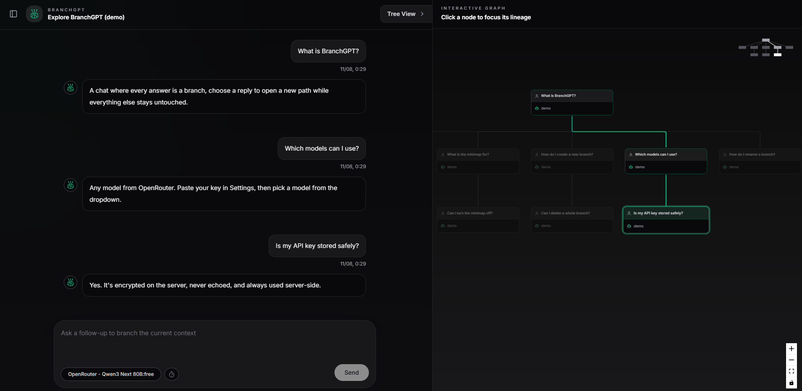
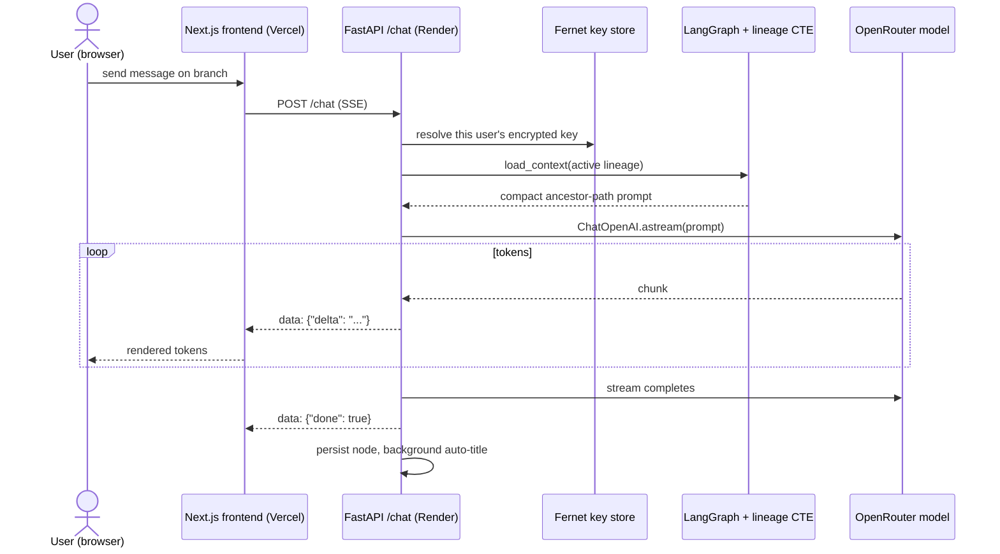
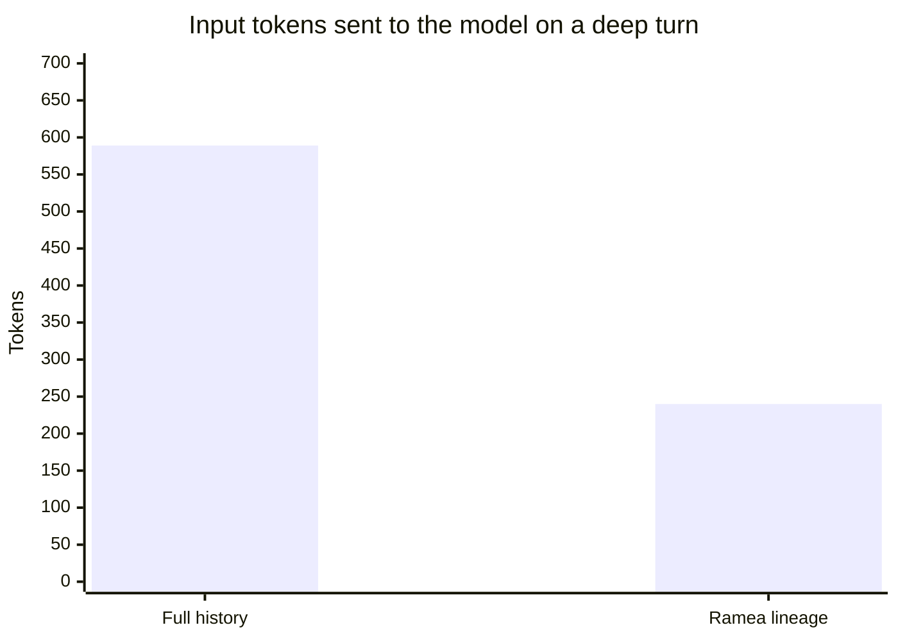
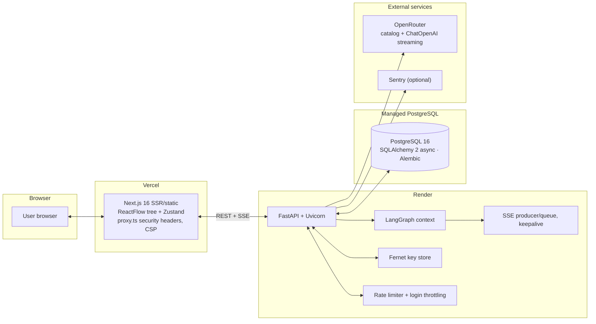
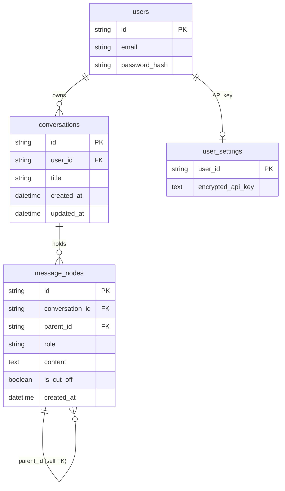

# Ramea Chat

Every AI chat has the same hidden tax. Each turn re-sends your entire history
to the model, so the longer a conversation gets, the more you pay for old
words you stopped caring about three topics ago, and the model spends more
attention on that history and less on what you just asked.

Ramea fixes that with one structural change. Each conversation is a tree,
not a transcript. You can branch an answer in a few directions, go deep in any
one of them, and return to an earlier turn whenever you want. The model only
ever receives the path of nodes you are currently following, so a deep
conversation costs a fraction of a linear one and stays sharp while it grows.

> Try it live without signing in: [https://www.ramea-chat.com/](https://www.ramea-chat.com/).
> The demo is fully usable as a guest, so you can see the branching working before you create an account.

## The problem it solves

Two related costs come with linear chat history.

**Token cost.** You pay per token, and a normal chat resends your whole
transcript (or at least a long cached prefix of it) on every single turn. The
repeated prefix is billed at a discounted cache-read rate rather than full
price, but it still grows with every message and is processed on every turn. A
long history stays per-turn expensive whichever way you slice it.

**Clutter and stagnation.** A long transcript is a wall of text. When you want
to explore a different approach, the options are both bad. Starting a new chat
throws away context, so the new thread begins blank and needs to restate the
setup before the model understands anything. Pushing forward in the same chat
keeps the context but buries the alternative idea, and the transcript only
grows longer.

## The core idea

Every message is a node in a tree. A new message continues the current thread
as a child node, or forks into a branch of its own. The app sends the model
only the ancestor path of the active message (root, then each node down to the
current turn), never the whole conversation.

```mermaid
flowchart LR
    subgraph linear["Linear chat, everything is re-sent"]
        L1[Q1] --> L2[A1] --> L3[Q2] --> L4[A2] --> L5[Q3] --> L6["A3 (your turn)"]
    end

    subgraph branch["Ramea, only the active path"]
        R[Q1] --> N1[A1]
        N1 --> N2["Q2 on branch A"]
        N2 --> N3["A2, active path"]
        N1 -. "alternate branch" .-> N4["Q2 on branch B"]
        N1 -. "another fork" .-> N5["Q2 on branch C"]
    end

    style L1 fill:#334155,stroke:#64748b
    style L2 fill:#334155,stroke:#64748b
    style L3 fill:#334155,stroke:#64748b
    style L4 fill:#334155,stroke:#64748b
    style L5 fill:#334155,stroke:#64748b
    style L6 fill:#334155,stroke:#64748b
    style N1 fill:#334155,stroke:#64748b
    style N2 fill:#334155,stroke:#64748b
    style N3 fill:#facc15,stroke:#ca8a04,color:#0f172a
    style N4 fill:#1e293b,stroke:#475569,color:#94a3b8
    style N5 fill:#1e293b,stroke:#475569,color:#94a3b8
```



The gray arrows are branches you are not following. While you work along the
yellow path they cost zero tokens and never pollute the answer.



*The branching tree, rendered in the live app.*

## Why this beats starting a new chat

There is a real difference between a tree and the new-chat button.

A new chat forgets everything. Exploring a different idea means restarting from
an empty thread and restating the whole setup, or accepting an answer that lacks
it. With a tree, the conversation starts as one normal thread and only forks
when you actually want a fork. When it does, every earlier node on the path is
still in the ancestry, so the model sees the full context that led to your
question. You get a clean new direction without an empty brain. Nothing forces
you to choose between context and a fresh start.

## What that does for you

### Lower cost per request

In a linear chat, cost grows with everything ever said. Here it grows with
depth, not size. From the offline suite in this repo (detailed in
[the proof](#the-proof-with-numbers-you-can-check)):

- about 60% fewer input tokens on a deep turn (240 vs 589 tokens on an
  8-branch conversation),
- roughly 3 times less input across a whole session (2,361 vs 6,713 tokens),
- and the saving grows faster than linearly, since untouched branches are free
  forever.

Fewer tokens means credits on the OpenRouter key stretch substantially further,
per message, per conversation, every day.

One honest nuance: provider prompt caches discount repeated prefixes, which
narrows the absolute gap to a linear chat at very large scale. Ramea does
not depend on that. Its context slice is small to begin with, so it never needs
a big cached prefix, and since branches share their upper nodes, a cached
prefix stays reusable when you switch branches.

### Better answers from focused context

Long histories are expensive, and they add noise. A model reading an
entire transcript guesses which of forty old messages still matter. The lineage
approach keeps context compact and the active path unambiguous, reducing drift,
hallucinations, and quietly degraded attention as a thread goes deep. The
LLM-judged tests here verify it directly (Faithfulness 1.000 and zero sibling
leakage on the recorded run).

### Conversations you can navigate

Because every turn is a node, a conversation becomes a small map of ideas
rather than a wall of text: fork in several directions, jump back to an earlier
fork in one click, compare alternatives side by side, and return days later to
pick up exactly where you left off. Unvisited branches cost nothing and stay
saved, so the map reads less like a chat log and more like a plan that grew
revisions instead of replacements.

## The AI engineering

Every subsystem below is real and running in production.

### Context engineering with one recursive CTE

The entire cost argument rests on the data layer. Messages live in a table with
a self-referencing foreign key, and a recursive CTE walks from the active node
up to the root to return exactly the branch being followed.

```text
WITH RECURSIVE ancestors AS (
    SELECT * FROM message_nodes WHERE id = :active
    UNION ALL
    SELECT m.* FROM message_nodes m
    JOIN ancestors a ON a.parent_id = m.id
)
SELECT * FROM ancestors ORDER BY created_at;
```

A LangGraph `load_context` step assembles that path into the prompt, so nothing
in the client decides what the model sees. With the graph as the single source
of truth for context, cross-branch and cross-user leakage is structurally hard
to introduce.

### Streaming built for unreliable connections

The chat endpoint is a server-sent-events (SSE) stream.



Three decisions matter under real load: a producer/queue pattern decouples the
model's async generator from the HTTP stream so back-pressure never stalls the
response; a keepalive comment every 15 seconds while the model thinks stops
proxies and browsers timing the connection out; and streaming runs through
`ChatOpenAI.astream` over OpenRouter, so any catalog model works rather than one
hard-coded provider.

### A model catalog that stays current

The model picker is driven by `GET /models`, which pulls OpenRouter's public
catalog (cached in memory for about a minute) and filters to text-only chat
models. The endpoint is deliberately keyless, so the catalog is browsable before
any API key has been configured.

### API keys encrypted at rest

Each user's OpenRouter key is stored encrypted at rest with Fernet, derived
from an `API_KEY_SECRET` environment value. `GET /api-key` only ever returns
`{ "hasKey": true }`; the key is resolved server-side on every chat request and
never returned to the browser. A leaked database does not leak usable keys.

### Eval-driven development

The claims above are not vibes. The repo ships an evaluation suite that checks
two things. The efficiency tests measure the token math deterministically with
OpenAI's tokenizer, offline and keyless. The quality tests generate real model
answers through the same pipeline the app uses, then judge them with a second,
stronger model via deepeval metrics: Faithfulness, Answer Relevancy,
Contextual Relevancy, and a GEval check that sibling-branch facts never leak
into an answer. The results are committed as a snapshot so the evidence is
reviewable without running anything.

### Constraints that keep it reliable

- an in-process rate limiter (sliding window, per IP and per user) so a noisy
  client cannot run up the bill,
- two-axis login throttling against credential stuffing,
- bounded inputs and outputs everywhere, including message caps,
- expired and temporary messages are pruned on read and by a background sweep,
- cross-conversation and cross-user isolation enforced at the CTE level,
- XSS-hardened rendering of model output (react-markdown with rehype-sanitize).

## The proof, with numbers you can check

The evaluation suite lives in [`deepeval-tests/`](deepeval-tests/README.md)
with a recorded [snapshot of results](deepeval-tests/results.md), readable with
zero setup. The efficiency test is a deterministic offline measurement (no API
key, no network); the quality tests are judged by a real model and skip
automatically when no key is present.

Efficiency, offline and reproducible:

| Test | Result |
| --- | --- |
| Active branch uses 240 tokens vs 589 for full history | 59.3% fewer |
| Whole session: 2,361 tokens (branch) vs 6,713 (linear replay) | about 3 times less |
| Seven sibling branches excluded from the context | 0 leakage |



LLM-judged quality, recorded run with a free judge
(`openai/gpt-oss-20b:free`):

| Check | Metric | Score | Verdict |
| --- | --- | --- | --- |
| Deep-branch context retained on follow-up | Faithfulness | 1.000 | PASS |
| Answer stays on-topic | Answer Relevancy | 1.000 | PASS |
| Does not invent absent facts | Faithfulness | 1.000 | PASS |
| Sibling-branch facts never leak into the answer | GEval | 1.000 | PASS |
| System prompt is followed | GEval | 1.000 | PASS |

The two halves are read together. Efficiency shows why it is cheap, quality
shows that cheap is still correct. [`deepeval-tests/results.md`](deepeval-tests/results.md)
explains the ratio-based Contextual Relevancy score.

The offline half reproduces in one command:

```bash
python -m pytest deepeval-tests -v
```

The LLM-judged checks need an OpenRouter key and skip automatically without one.

Or skip the numbers and try it yourself as a guest, no login needed:
[**https://www.ramea-chat.com/**](https://www.ramea-chat.com/)

## Architecture and deployment



How the services fit together:

- Frontend: Next.js 16 on Vercel, with server and client components separated
  and a proxying middleware injecting security headers and a CSP.
- Backend: FastAPI on Render owning the tree queries, LangGraph context,
  encrypted key store, and SSE stream.
- Data: managed PostgreSQL via async SQLAlchemy, migrated with Alembic before
  the backend starts.
- Models: OpenRouter for the catalog and streaming; Sentry optionally captures
  backend errors.
- The same stack also runs fully self-hosted with Docker Compose (Postgres,
  backend, frontend, healthchecks, pinned base images).
- CI runs backend tests against real Postgres, the offline efficiency suite,
  dependency audit scans, and frontend lint, type-check, and production build.

## Data model

Four tables carry the whole product. The lineage recursion lives in the
self-referencing foreign key on `message_nodes`.



`parent_id` points at the node a message forks from (`NULL` marks a root), and a
path of nodes is a branch, the same path the recursive CTE walks.

## Tech stack

| Layer | Tooling | Why |
| --- | --- | --- |
| Backend API | FastAPI, Uvicorn | async-first Python, typed, sane defaults |
| Data | SQLAlchemy 2 async, asyncpg, Alembic, PostgreSQL 16 | recursive CTEs and clean migrations |
| AI orchestration | LangGraph, LangChain (`ChatOpenAI`), OpenRouter | one graph for context and streaming, hundreds of models |
| Cryptography | `cryptography` (Fernet) | API keys encrypted at rest |
| Frontend | Next.js 16, TypeScript, React, Tailwind | App Router, strict types, security headers |
| Graph UI | ReactFlow | the interactive tree canvas |
| State and data | Zustand (persisted), TanStack Query | local-first UX and cached server state |
| Rendering | react-markdown + rehype-sanitize | markdown from the model, rendered safely |
| Testing | pytest, pytest-asyncio, deepeval, tiktoken | 246 backend tests plus the LLM-judged suite |
| Delivery | Vercel, Render, managed Postgres, GitHub Actions, Docker Compose | production + self-hosted + CI paths |

## What is in this repository

```
public-repo/
├── README.md              # this file
├── assets/                # logo.svg + screenshot.png (avatar, UI shot)
└── deepeval-tests/        # the efficiency + quality proof suite, results.md included
```

The product source stays private; the suite is included so every claim here is
verifiable.

## Built out of a real frustration

Every chat app I used eventually drowned in its own history. That frustration
is why this product exists, and a lot of the README above came out of making
it real: a recursive CTE for context, an async streaming backend, keys
encrypted at rest, and tests that check the claims instead of vibes. This
repository is the readable version of that work.


© 2026 Ramea Chat. Released under the MIT License.