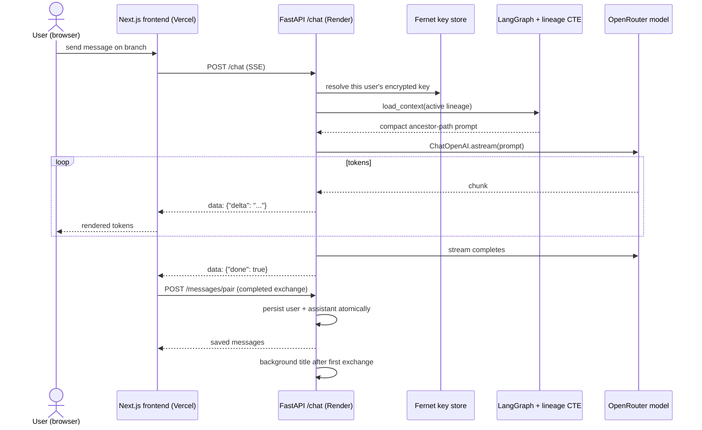
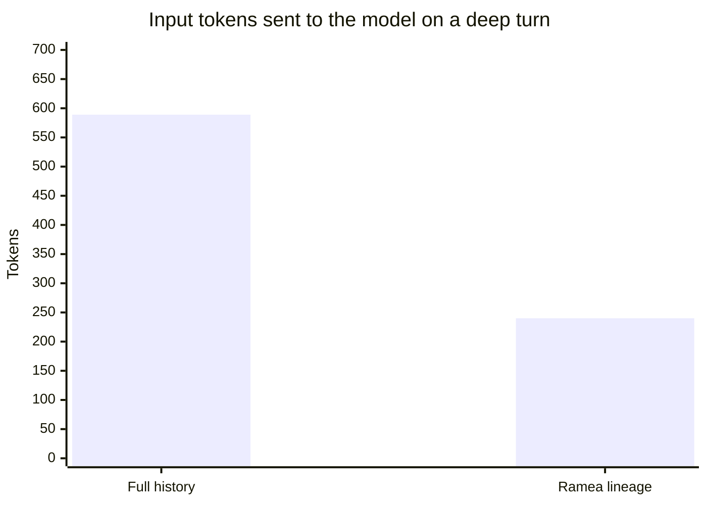
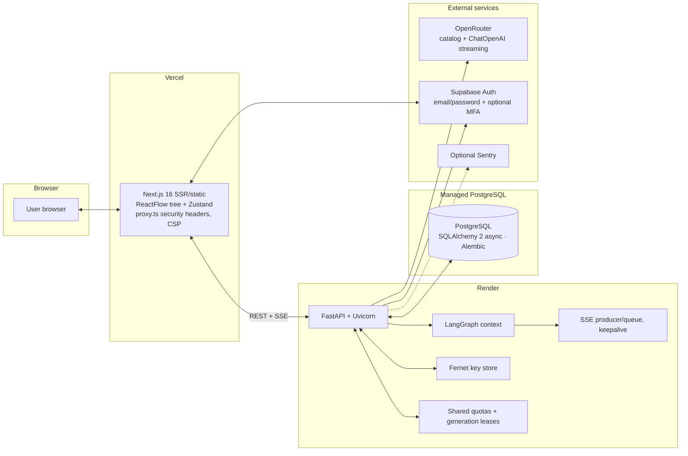
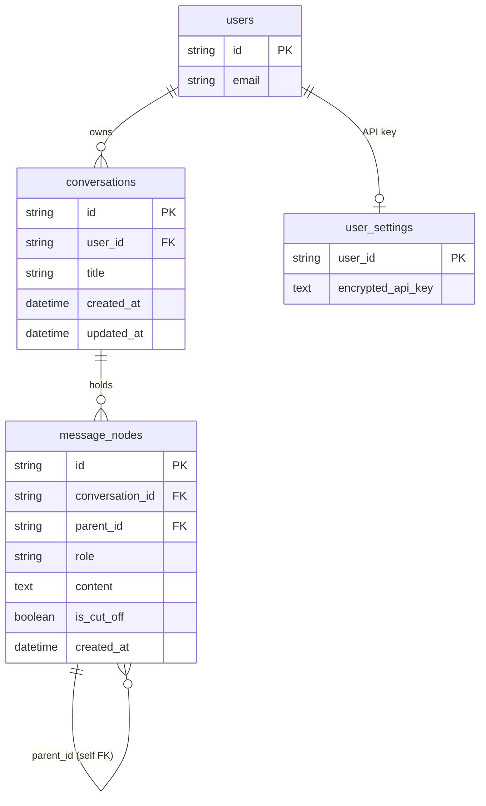

# Ramea Chat

A long AI chat can carry a hidden tax. Each turn often re-sends its history
to the model, so the longer a conversation gets, the more you pay for old
words you stopped caring about three topics ago, and unrelated messages can make the context harder to follow.

Ramea fixes that with one structural change. Each conversation is a tree,
not a transcript. You can branch an answer in a few directions, go deep in any
one of them, and return to an earlier turn whenever you want. The model only
ever receives the path of nodes you are currently following, so a deep
conversation can use less input than replaying every branch as one transcript.

> Try it live without signing in: [https://www.ramea-chat.com/](https://www.ramea-chat.com/).
> Open Ramea to browse the read-only demo and switch between its branches.
> To chat with a model, create an account and connect your own OpenRouter key.
> The application source is private; this repository explains the project and shares its evaluation suite.

## The problem it solves

Two related costs come with linear chat history.

**Token cost.** You pay per token, and a normal chat resends your whole
transcript (or at least a long cached prefix of it) on every single turn. The
repeated prefix may qualify for a discounted cache-read rate, depending on the
provider and model. Some systems also summarize or truncate history; the
comparison here is with full-history replay.

**Clutter and stagnation.** A long transcript is a wall of text. When you want
to explore a different approach, the options are both bad. Starting a new chat
throws away context, so the new thread begins blank and needs to restate the
setup before the model understands anything. Pushing forward in the same chat
keeps the context but buries the alternative idea, and the transcript only
grows longer.

## The core idea

Every message is a node in a tree. A new message continues the current thread
as a child node, or forks into a branch of its own. The app sends the model
only the ancestor path of the active message (root, then each node down to the
current turn), excluding sibling branches. The visual tree groups each user
question and assistant reply into one exchange; Branch is available on assistant
messages. Deleting that exchange removes both messages and its descendants.



```mermaid
flowchart LR
    subgraph linear["Linear chat, everything is re-sent"]
        L1[Q1] --> L2[A1] --> L3[Q2] --> L4[A2] --> L5[Q3] --> L6["A3 (your turn)"]
    end

    subgraph branch["Ramea, only the active path"]
        R[Q1] --> N1[A1]
        N1 --> N2["Q2 on branch A"]
        N2 --> N3["A2, active path"]
        N1 -. "alternate branch" .-> N4["Q2 on branch B"]
        N1 -. "another fork" .-> N5["Q2 on branch C"]
    end

    style L1 fill:#334155,stroke:#64748b
    style L2 fill:#334155,stroke:#64748b
    style L3 fill:#334155,stroke:#64748b
    style L4 fill:#334155,stroke:#64748b
    style L5 fill:#334155,stroke:#64748b
    style L6 fill:#334155,stroke:#64748b
    style N1 fill:#334155,stroke:#64748b
    style N2 fill:#334155,stroke:#64748b
    style N3 fill:#facc15,stroke:#ca8a04,color:#0f172a
    style N4 fill:#1e293b,stroke:#475569,color:#94a3b8
    style N5 fill:#1e293b,stroke:#475569,color:#94a3b8
```

The gray arrows are branches you are not following. While you work along the
yellow path, the other branches add no input tokens to that request.


*The branching tree, rendered in the live app.*

## Why this beats starting a new chat

There is a real difference between a tree and the new-chat button.

A new chat forgets everything. Exploring a different idea means restarting from
an empty thread and restating the whole setup, or accepting an answer that lacks
it. With a tree, the conversation starts as one normal thread and only forks
when you actually want a fork. When it does, every earlier node on the path is
still in the ancestry, so the model sees the full context that led to your
question. You get a clean new direction without an empty brain. Nothing forces
you to choose between context and a fresh start.

## What that does for you

### Lower cost per request

In a linear chat, cost grows with everything ever said. Here it grows with
depth, not size. From the offline suite in this repo (detailed in
[the proof](#the-proof-with-numbers-you-can-check)):

- about 60% fewer input tokens on a deep turn (240 vs 589 tokens on an
  8-branch conversation),
- roughly 3 times less input across a whole session (2,361 vs 6,713 tokens),
- sibling branches add no input tokens to a request on another path.

These are input-token measurements on the recorded example, not a promise of
the same bill reduction for every conversation. Actual cost also depends on
the model, output length and provider caching.

One honest nuance: where provider caching applies, discounted repeated prefixes
can narrow the price gap to a linear chat. Ramea does
not depend on caching. Branches share earlier messages, so their common prefix
may also be reusable where the provider supports it. A long active path can
still be expensive; branching removes sibling context, not its own history.

### Better answers from focused context

Long histories are expensive, and they add noise. A model reading an
entire transcript guesses which of forty old messages still matter. The lineage
approach keeps the active path unambiguous. The recorded LLM-judged examples
scored Faithfulness 1.000 and found no sibling leakage. Those are results for
these test cases, not a guarantee against hallucinations or proof that every
answer will improve.

### Conversations you can navigate

Because every turn is a node, a conversation becomes a small map of ideas
rather than a wall of text: fork in several directions, jump back to an earlier
fork in one click, switch between alternatives, and return days later to
pick up where you left off. The app restores your selected path after refresh.
Saved branches stay available until deletion or temporary-message expiry, so
the map reads less like a chat log and more like a plan that grew revisions
instead of replacements.

## The AI engineering

The sections below describe the deployed app. The public evaluation suite is
self-contained: it tests token math and model behavior with representative
branch context, without importing the private application source.

### Context engineering with one recursive CTE

The entire cost argument rests on the data layer. Messages live in a table with
a self-referencing foreign key, and a recursive CTE walks from the active node
up to the root to return exactly the branch being followed.

```text
WITH RECURSIVE ancestors AS (
    SELECT m.*, 0 AS depth FROM message_nodes m WHERE id = :active
    UNION ALL
    SELECT m.*, a.depth + 1 FROM message_nodes m
    JOIN ancestors a ON a.parent_id = m.id
    WHERE m.conversation_id = a.conversation_id
)
SELECT * FROM ancestors ORDER BY depth DESC;
```

This is a shortened example. The actual query also scopes the starting message
to its owner and bounds traversal depth. Ordering by depth returns the path
from root to active message.

A LangGraph `load_context` step assembles that path into the prompt, so nothing
in the client decides what the model sees. With the graph as the single source
of truth for context, cross-branch and cross-user leakage is structurally hard
to introduce.

### Streaming built for unreliable connections

The chat endpoint is a server-sent-events (SSE) stream.



Three decisions matter under real load: a producer/queue pattern decouples the
model's async generator from the HTTP stream; a keepalive comment every 15
seconds while the model thinks helps prevent idle-proxy timeouts; and streaming runs through
`ChatOpenAI.astream` over OpenRouter, so any catalog model works rather than one
hard-coded provider. Requests are checked against the server catalog.

The frontend saves a completed exchange after an explicit SSE completion event.
User and assistant messages are saved together, with idempotent retries. An
unexpected EOF is an interrupted reply, not a successful save. You can type
your next draft or switch tree paths while a reply streams; Stop cancels it.

After the first successful exchange, a background task requests a short title
using the user's stored key. It sends at most 384 characters of the first prompt
and requests at most 16 output tokens from a separately configured inexpensive
model. History updates without a refresh. Normally there is one title request
per conversation; failures retain the fallback and allow limited later attempts.
Title generation does not hold up the chat response.

### A model catalog that stays current

The model picker is driven by `GET /models`, which pulls OpenRouter's public
catalog (cached in memory for about a minute) and filters to text-only chat
models. The endpoint is deliberately keyless, so the catalog is browsable before
any API key has been configured.

### API keys encrypted at rest

Each user's OpenRouter key is stored encrypted at rest with Fernet, derived
from an `API_KEY_SECRET` environment value. `GET /api-key` only ever returns
`{ "hasKey": true }`; the key is resolved server-side on every chat request and
never returned to the browser. Production requires a stable, externally
configured encryption secret, kept separately from the database.

### Eval-driven development

The claims above are not vibes. The repo ships an evaluation suite that checks
two things. The efficiency tests measure the token math deterministically with
OpenAI's tokenizer, offline and keyless. The quality tests generate real model
answers through OpenRouter from fixed branch-context fixtures, then judge
them with the configured evaluation model through deepeval metrics:
Faithfulness, Answer Relevancy,
Contextual Relevancy, and a GEval check that sibling-branch facts never leak
into an answer. The results are committed as a snapshot so the evidence is
reviewable without running anything.

### Constraints that keep it reliable

- PostgreSQL-backed production rate budgets and concurrent-generation leases
  shared across backend processes, with per-user hourly request caps,
- Supabase email/password authentication and optional authenticator-app MFA,
  with backend JWT issuer, audience, session and assurance-level validation,
- server model validation, bounded context/output and generation deadlines,
  plus conversation/message caps,
- expired and temporary messages are pruned on read and by a background sweep,
- cross-conversation and cross-user isolation enforced at the CTE level,
- XSS-hardened rendering of model output (react-markdown with rehype-sanitize).

## The proof, with numbers you can check

The evaluation suite lives in [`deepeval-tests/`](deepeval-tests/README.md)
with a recorded [snapshot of results](deepeval-tests/results.md), readable with
zero setup. The efficiency test is a deterministic offline measurement (no API
key, no network); the quality tests are judged by a real model and skip
automatically when no key is present.

Efficiency, offline and reproducible:

| Test | Result |
| --- | --- |
| Active branch uses 240 tokens vs 589 for full history | 59.3% fewer |
| Whole session: 2,361 tokens (branch) vs 6,713 (linear replay) | about 3 times less |
| Seven sibling branches excluded from the context | 0 leakage |



LLM-judged quality, recorded August 2026 run with the then-free judge
(`openai/gpt-oss-20b:free`):

| Check | Metric | Score | Verdict |
| --- | --- | --- | --- |
| Deep-branch context retained on follow-up | Faithfulness | 1.000 | PASS |
| Answer stays on-topic | Answer Relevancy | 1.000 | PASS |
| Does not invent absent facts | Faithfulness | 1.000 | PASS |
| Sibling-branch facts never leak into the answer | GEval | 1.000 | PASS |
| System prompt is followed | GEval | 1.000 | PASS |

The two halves are read together. Efficiency shows why it is cheap, quality
checks grounding and branch isolation in the recorded examples. [`deepeval-tests/results.md`](deepeval-tests/results.md)
explains the ratio-based Contextual Relevancy score.

The offline half reproduces in one command:

```bash
pip install -r requirements.txt
python -m pytest deepeval-tests -m efficiency -v
```

The LLM-judged checks need an OpenRouter key and skip automatically without one.

Or skip the numbers and try it yourself as a guest, no login needed:
[**https://www.ramea-chat.com/**](https://www.ramea-chat.com/)

## Architecture and deployment



How the services fit together:

- Frontend: Next.js 16 on Vercel. `/` is the public landing; `/app` is the
  product. App providers, authentication and ReactFlow stay out of the landing
  bundle. Middleware injects security headers and a CSP.
- Backend: FastAPI on Render owning the tree queries, LangGraph context,
  encrypted key store, and SSE stream.
- Data: managed PostgreSQL via async SQLAlchemy, migrated with Alembic before
  the backend starts.
- Authentication: Supabase owns passwords and sessions; the backend verifies
  tokens and conversation ownership.
- Models: OpenRouter for the catalog, streaming and inexpensive background
  titles. Sentry reporting is optional and off unless explicitly enabled.
- The same stack also runs fully self-hosted with Docker Compose (Postgres,
  backend, frontend, healthchecks, pinned base images).
- CI runs backend tests against real Postgres, the offline efficiency suite,
  production dependency audits, frontend tests, lint, type-check, production
  build and landing bundle isolation.

## Data model

The diagram shows the core application tables, not the full schema. Supabase
handles authentication; the local user record links its identity to owned
conversations and settings. Production quota buckets and generation leases
live in separate tables. The ancestor query follows `message_nodes.parent_id`.



`parent_id` points at the node a message forks from (`NULL` marks a root), and a
path of nodes is a branch, the same path the recursive CTE walks.

## Tech stack

| Layer | Tooling | Why |
| --- | --- | --- |
| Backend API | FastAPI, Uvicorn | async-first Python, typed, sane defaults |
| Data | SQLAlchemy 2 async, asyncpg, Alembic, PostgreSQL | recursive CTEs and clean migrations |
| AI orchestration | LangGraph, LangChain (`ChatOpenAI`), OpenRouter | server-built branch context and OpenRouter streaming |
| Authentication | Supabase Auth | email/password, sessions and optional TOTP MFA |
| Cryptography | `cryptography` (Fernet) | API keys encrypted at rest |
| Frontend | Next.js 16, TypeScript, React, Tailwind | App Router, strict types, security headers |
| Graph UI | ReactFlow | the interactive tree canvas |
| State and data | Zustand (persisted), TanStack Query | local-first UX and cached server state |
| Rendering | react-markdown + rehype-sanitize | markdown from the model, rendered safely |
| Testing | pytest, pytest-asyncio, Vitest, deepeval, tiktoken | 325 backend tests, 111 frontend tests and 4 offline efficiency tests at the MVP release, plus the recorded LLM suite |
| Delivery | Vercel, Render, managed Postgres, GitHub Actions, Docker Compose | production + self-hosted + CI paths |

## What is in this repository

```
repository/
├── README.md              # this file
├── assets/                # logo.svg + screenshot.png (avatar, UI shot)
└── deepeval-tests/        # the efficiency + quality proof suite, results.md included
```

The product source stays private. This repository includes the standalone
evaluation suite and recorded results; the private backend/frontend regression
tests are not included. The screenshot is illustrative and may predate the
current interface.

## Built out of a real frustration

Every chat app I used eventually drowned in its own history. That frustration
is why this product exists, and a lot of the README above came out of making
it real: a recursive CTE for context, an async streaming backend, keys
encrypted at rest, and tests that check the claims instead of vibes. This
repository is the readable version of that work.


© 2026 Ramea Chat. The materials and evaluation code in this repository are
released under the MIT License. The private application source is not included
or licensed by this repository.